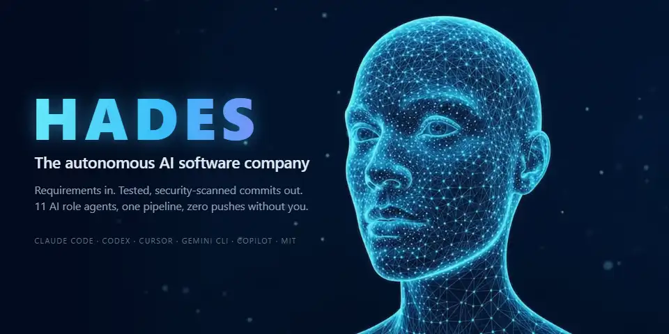
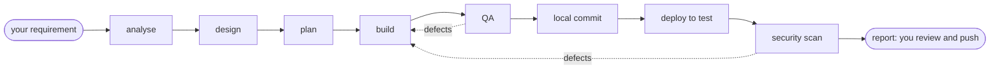

<p align="center">
  
</p>

<h1 align="center">HADES: Autonomous AI Software Company for Claude Code</h1>

<p align="center"><em>An open-source multi-agent coding team: AI agents that analyse, build, test, secure and commit your code.</em></p>

<p align="center">
  <strong>Type one requirement. Get back tested, security-scanned commits, without burning your token budget.</strong>
</p>

<p align="center"><sub>A project by <a href="https://hadesvault.com">HadesVault.com</a></sub></p>

<p align="center">
  <a href="LICENSE"></a>
  <a href="https://nodejs.org"></a>
  <a href="https://code.claude.com"></a>
  
  <a href="CONTRIBUTING.md"></a>
  <a href="https://github.com/prasadm1022/hades-vault/stargazers"></a>
</p>

<p align="center">
  <a href="#quick-start">Quick start</a> ·
  <a href="#reduce-claude-code-token-usage">Token savings</a> ·
  <a href="#how-to-use-hades">How to use it</a> ·
  <a href="#use-hades-with-codex-cursor-gemini-cli-and-github-copilot">Codex, Cursor, Copilot...</a> ·
  <a href="#faq">FAQ</a>
</p>

---

You already know the problem: one AI chat writes the code, says "done", and you discover the
missing tests, the leaked key and the broken edge case later. Meanwhile it re-reads the same files
and pours whole build logs into its context, and your token bill climbs.

**HADES is an open-source multi-agent framework that turns [Claude Code](https://code.claude.com)
into an autonomous AI software company.** A team of Claude Code subagents (business analyst,
software architect, tech lead, backend, frontend, AI/ML and QA engineers, DevOps and a cybersecurity
engineer) each do their part, check each other's work, and hand you **local commits and a report**.
It never pushes: you review and push. The same AI dev team also runs in OpenAI Codex, Cursor,
Gemini CLI and GitHub Copilot.

```text
/hades portal Customers can reset their password by email. Links expire after 30 minutes.
```

That one line gets you acceptance criteria, a design, a work plan, the code, tests, a QA pass,
security scans, a deploy to your test environment (if you set one up) and a report of exactly what
changed.

## Why developers use HADES

| | |
|---|---|
| 🧠 **A team, not a single chat** | 11 specialised agents. A role with nothing to do is never started. |
| ✅ **"Done" means proven** | A stage passes only on real evidence: builds, tests, scanners, health checks. Never on an agent saying so. |
| 🔒 **Safe by default** | A guard blocks `git push`, destructive git, secret reads and publishing, even in fully automatic mode. |
| 💰 **Fewer tokens per result** | Short handoffs, trimmed tool output, cheap models for simple work. [See how](#reduce-claude-code-token-usage). |
| 🧩 **Remembers your projects** | Lessons and project knowledge go into a private vault, so the next task starts smarter. |
| 🔌 **Not locked in** | Also exports to OpenAI Codex, Cursor, Gemini CLI, GitHub Copilot, Devin, Cline and OpenCode. |

## Reduce Claude Code token usage

Spend tokens where they count. Whether you use Claude Code or another AI coding assistant, tokens
are your budget. Most of what a
single long chat spends goes on re-reading files, scrolling logs and dragging old conversation along.
HADES is built to cut that waste:

- **Logs shrink to a few lines.** `hades gate` turns a 5,000-line build or test log into one line
  per step plus the first failure (30 lines at most). The full log stays on disk if anyone needs it.
- **Handoffs are pointers, not copies.** An agent gets at most 15 lines of file paths, returns at most
  8 lines, and reads a 10-line summary at the top of each document instead of the whole file.
- **The right model for each job.** Strong models for analysis, architecture and security; faster,
  cheaper ones for well-specified coding, QA and DevOps; the cheapest one for file lookups.
- **Code is read by symbol, not by file.** Agents jump to the function they need (via Serena)
  instead of loading whole files.
- **Scripts do the mechanical work for free.** Stack detection, plan checks, test coverage, quality
  gates and the safety guard are plain code that costs zero model tokens.
- **Learn once, reuse forever.** Build commands and project knowledge are found once and saved, so
  later tasks don't rediscover them.
- **Small tasks stay small.** A one-file fix skips planning and writes short notes, not full documents.
- **You see the bill.** `hades usage --task <id>` reports tokens and estimated cost per task, and
  `hades run --max-budget-usd 20` caps an unattended run.

To be honest about it: a full pipeline runs several agents, so it costs more than a quick one-off
edit in a plain chat. For that, use a plain chat. HADES pays off on real features, where the
alternative is a long chat that re-reads everything and still needs your review.
[How it works in detail](docs/token-economy.md).

## Quick start

You need Node.js 22+, git and Claude Code 2.1.271+ ([full list](#requirements)). Pick a workspace
folder that holds your projects, for example `~/code` (or `C:\code` on Windows):

```bash
cd ~/code
git clone --recurse-submodules --shallow-submodules https://github.com/prasadm1022/hades-vault.git
cd hades-vault
node bin/hades.mjs init          # creates your private vault in .vault/
node bin/hades.mjs tools setup   # installs the pinned scanners and tools
node bin/hades.mjs install       # adds the agents, skills and guard to Claude Code
node bin/hades.mjs doctor        # checks everything; fix any FAIL
```

On Windows, run `git config --global core.longpaths true` first; the same commands work in PowerShell.

Then open Claude Code in your workspace and try it on a project you already have:

```bash
cd ~/code
claude
```

```text
/hades-new-team portal acme/portal --org acme
/hades portal Customers can reset their password by email
```

The first line teaches HADES your project (once per project). The second runs a requirement.

## Requirements

| You need | For |
|---|---|
| Node.js 22 or newer | the CLI and the guard (no npm dependencies) |
| git | everything |
| Claude Code 2.1.271 or newer | the runtime (`claude update`) |
| [uv](https://docs.astral.sh/uv/) | Serena, Semgrep and the AWS tools |
| Docker (optional) | ZAP security scans |
| AWS CLI v2 (optional) | deploying to AWS |

Works on Windows, macOS and Linux. On Windows, WSL2 gives you OS-level isolation as well.

## How to use HADES

Type these slash commands in Claude Code, started in your workspace folder.

| Do this | Type |
|---|---|
| Teach HADES an existing project (once) | `/hades-new-team portal acme/portal --org acme` |
| Build a feature or fix a bug | `/hades portal <what you want, in plain words>` |
| Start a brand-new product | `/hades acme A booking site for our two clinics` |
| From inside a project folder | `/hades <what you want>` |
| See what's running | `/hades-status` |
| Resume an interrupted task | `/hades portal continue portal-001` |
| Teach it something | `/hades-learn portal portal-001 The staging database resets every night.` |

**When it finishes**, you get a report: `DONE` or `BLOCKED`, what was built, test and security
results, the commits to review, and the token cost. Review and push yourself:

```bash
git -C ../acme/portal log --oneline -5
git -C ../acme/portal push
```

**Run it with no prompts at all** from a terminal:

```bash
node bin/hades.mjs run "Customers can reset their password by email" --team portal --max-budget-usd 20
```

**Let it deploy** by telling it how your test environment works (otherwise it prepares the deploy
setup and stops there):

```bash
node bin/hades.mjs team set portal env test deploy "npm run deploy:test"
node bin/hades.mjs team set portal env test health "curl -fsS https://test.example.com/health"
```

By default Claude Code still asks before some steps of the main session. For hands-off use, install
with `node bin/hades.mjs install --autonomy full`. That turns off prompts for **every** Claude Code
session on your account; the guard keeps blocking pushes and secret reads either way.

More: [step-by-step guide](docs/getting-started.md) · [every command](docs/cli.md) ·
[configuration and troubleshooting](docs/reference.md).

## How the multi-agent pipeline works



- Your main Claude Code session becomes the **Project Manager**. It starts each specialist only
  when there's work for it, and runs engineers in parallel where files don't overlap.
- QA doesn't trust the engineers, and security doesn't trust QA. Defects go back to the owner, up to
  3 fix rounds, after which they're reported as blocked.
- Task size (S, M, L) sets the depth: a copy change gets a light pass, a new payments flow gets the
  full treatment.

**HADES compared with a single AI coding session:**

|  | A plain AI chat | HADES |
|---|---|---|
| Who checks the work | the same chat that wrote it | separate QA and security agents |
| "Done" means | the model says so | tests, scanners and health checks pass |
| Security testing | whatever you run | Gitleaks, Semgrep, Trivy, ZAP and a manual review |
| `git push` | up to your settings | always blocked; you push |
| Memory between tasks | the chat history | a private vault of project knowledge |

Details: [architecture](docs/architecture.md) · [operating protocol](HADES.md).

## Safe AI coding agents by default

- **It never pushes, opens pull requests or publishes packages.** You review the commits and push.
- **A guard checks every action first.** It runs as a Claude Code hook (matcher
  `Bash|PowerShell|Read|Write|Edit|MultiEdit|NotebookEdit|Grep|mcp__serena__.*`) in every permission
  mode and inside every agent. It blocks pushes, history rewrites, mass deletes, secret reads,
  publishing, and writes outside each role's folder.
- **Active security scans run only against test or local targets**, never your live site.
- **Credentials are never read.** Agents refer to them by environment-variable or profile name only.

Know the limits: the guard reads command text and isn't a sandbox. Input too complex to verify is
blocked (`guard.limit`), and if the guard itself fails, calls containing a high-risk keyword such as
`push` or `rm` are blocked. For unattended runs, use Claude Code's sandbox (macOS, Linux) or WSL2, a
VM or a dev container. Read the diff before you push: a change can pass every check and still be
wrong. Full details: [autonomy and safety](docs/autonomy-and-safety.md).

## Use HADES with Codex, Cursor, Gemini CLI and GitHub Copilot

`hades export <target>` sets up the same AI agent team for another coding agent:

```bash
node bin/hades.mjs export codex     # or cursor, gemini, copilot, windsurf (Devin), cline, opencode, agents-md
```

| Agent | Support |
|---|---|
| Claude Code | **Full**: every feature, enforced |
| OpenAI Codex, Cursor, Gemini CLI, GitHub Copilot, Devin, OpenCode 1.x | **Good**: separate role agents and the guard; usually one model for every role |
| Cline, OpenCode 2.x, Aider, any `AGENTS.md` tool | **Basic**: one agent plays every role; keep approvals on |

Export formats follow each vendor's documentation and haven't been tested end to end on every
platform. Setup per agent: [docs/other-agents.md](docs/other-agents.md).

## FAQ

**What is HADES?** An open-source autonomous AI software company for Claude Code. Your main Claude
Code session becomes a project manager that runs a team of specialised Claude Code subagents through
analysis, design, build, QA, deploy and security testing, and ends with local git commits.

**How do I run multiple Claude Code subagents as a team?** Install HADES, onboard a project with
`/hades-new-team <team> <project-path>`, then type `/hades <team> <requirements>`. HADES starts
each subagent when its stage begins, in parallel where the files don't overlap.

**How can I reduce Claude Code token usage?** HADES trims build and test logs to a few lines, passes
file pointers instead of content between agents, routes simple work to cheaper models and reads code
by symbol. `hades usage` shows the tokens and cost of every task. [Details](#reduce-claude-code-token-usage).

**Will it cost more tokens than a normal chat?** For a one-line fix, yes: use a normal chat. For a
real feature, HADES avoids most of a long chat's waste and shows you the exact cost per task.

**Is HADES free?** Yes: HADES is MIT-licensed open source. You pay your model provider as usual.

**Does it push to GitHub?** Never. It commits locally; you review and push.

**Can AI agents build a whole new app with HADES?** Yes. Describe the product, and it picks a stack,
sets up the repository, CI and deploy configuration, then builds, tests and scans it. It stops at
local commits for you to review.

**Does it work with Cursor, Codex, Gemini CLI or GitHub Copilot?** Yes, through `hades export`.
Claude Code has full support; the others have good or basic support
([details](#use-hades-with-codex-cursor-gemini-cli-and-github-copilot)).

**Is my code private?** Your code stays in your repositories, and task records stay in your private
vault, which is never committed with HADES. HADES itself has no telemetry. As with any coding agent,
the files being worked on go to your model provider.

**Which tech stacks?** Most. It detects many ecosystems and monorepos, and learns new technologies
into your vault.

<details>
<summary><strong>Why is the repository called hades-vault?</strong></summary>

This repository is **hades-vault**: two parts in one folder.

- **HADES** is the open-source platform: the `hades` CLI, the agents, the `/hades` skills, the guard,
  policies and playbooks.
- **The vault** is your private knowledge base: registry, teams, knowledge and task records. Its
  default location is `.vault/` inside this folder. It's git-ignored here and has its own git
  repository, so your data is never published with the platform. Back it up to a **private** remote:

```bash
git -C .vault add -A
git -C .vault commit -m "Initial vault"
git -C .vault remote add origin <your-private-repository-url>
git -C .vault push -u origin HEAD
```

</details>

## Documentation

[Getting started](docs/getting-started.md) · [Reference and troubleshooting](docs/reference.md) ·
[CLI](docs/cli.md) · [Architecture](docs/architecture.md) · [Token economy](docs/token-economy.md) ·
[Autonomy and safety](docs/autonomy-and-safety.md) · [Other coding agents](docs/other-agents.md) ·
[Tools](docs/tools.md) · [File formats](docs/file-formats.md) · [Migration from v1](docs/migration-from-v1.md) ·
[Changelog](CHANGELOG.md)

## Contributing, security, license

**Contributing.** Pull requests are welcome: see [`CONTRIBUTING.md`](CONTRIBUTING.md). Good first
contributions are technology playbooks, deploy recipes and guard rules with tests. Run `npm test`
first.

**Security.** Report vulnerabilities privately with GitHub's
[Report a vulnerability](https://github.com/prasadm1022/hades-vault/security/advisories/new) button
([`SECURITY.md`](SECURITY.md)), never in a public issue.

**License.** [MIT](LICENSE) covers the HADES source in this repository only. The tools under
`tools/` keep their own licenses: see [`THIRD_PARTY_NOTICES.md`](THIRD_PARTY_NOTICES.md).

**Built on** [Serena](https://github.com/oraios/serena), [Playwright MCP](https://github.com/microsoft/playwright-mcp),
[REA](https://github.com/morluto/rea), [Gitleaks](https://github.com/gitleaks/gitleaks),
[Semgrep](https://github.com/semgrep/semgrep), [Trivy](https://github.com/aquasecurity/trivy),
[ZAP](https://github.com/zaproxy/zaproxy), [ccusage](https://github.com/ryoppippi/ccusage) and the
[AWS Agent Toolkit](https://github.com/aws/agent-toolkit-for-aws) and
[MCP Proxy for AWS](https://github.com/aws/mcp-proxy-for-aws). Product names are trademarks of their owners.

**Author.** A project by [HadesVault.com](https://hadesvault.com), built by Prasad Madusanka
([@prasadm1022](https://github.com/prasadm1022)).

## Star History

<a href="https://star-history.com/#prasadm1022/hades-vault&Date">
  
</a>

If HADES saves you time or tokens, please **star the repository**: it helps other developers find it.
